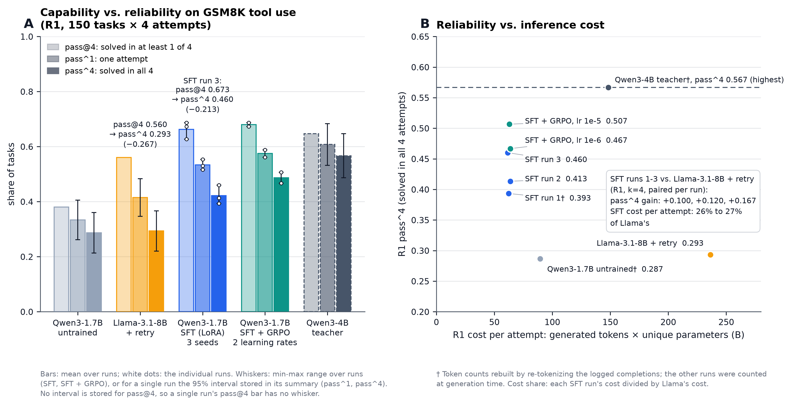
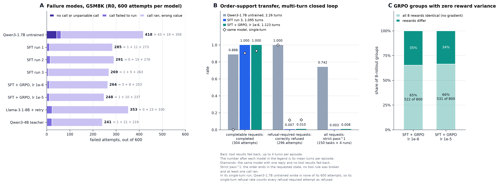
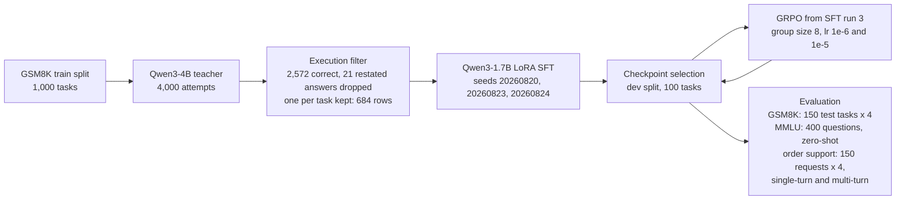

# Tool-Use Reliability in Small Language Models: Distillation, RL Post-Training, and Policy Transfer

[](https://github.com/DEZ-byte/agent-reliability/actions/workflows/ci.yml)

Single-attempt accuracy does not show consistency. A model that solves every
task half the time and a model that always solves half the tasks and never the
rest have the same accuracy. pass^k separates them: a task counts
only when all k independent attempts succeed. This project asks whether
execution-verified distillation (LoRA SFT on teacher trajectories whose
calculator calls ran to the right answer) and GRPO with an execution-backed
reward can make Qwen3-1.7B more reliable than Llama-3.1-8B-Instruct wrapped in
a retry scaffold, measured by pass^4 on calculator-backed GSM8K problems. It
also measures what that training does to general knowledge (MMLU) and to
refusal behavior in an order-support environment the model never trained on.

## Key findings

- **SFT beats the scaffolded 8B on strict reliability, at about a quarter
  of its cost, but stays below its teacher.** All three SFT seeds improve R1
  pass^4 over Llama-3.1-8B with retry, paired on the same tasks, by +0.100,
  +0.120 and +0.167, and every 95% interval excludes zero (run 3: +0.167, interval
  [+0.080, +0.253], permutation p = 0.001). One SFT attempt costs 26% to 27%
  of one 8B attempt, counting generated tokens times unique parameters. The
  untrained Qwen3-4B that wrote the training data still leads, with pass^4
  0.567 against 0.393 to 0.460 for the three SFT runs.
- **GRPO from SFT run 3 gave at most a small gain, and most groups gave no gradient.**
  R0 pass^1 rose by +0.008 at learning rate 1e-6, the rate the training config
  pins, and by +0.035 at 1e-5. The 1e-5 run overrode the pinned rate and was
  started after the 1e-6 test result was known, so it is an exploratory
  follow-up, not a pre-registered test. Its pass^1 interval [+0.005, +0.068]
  excludes zero, with permutation p = 0.040 and exact sign test p = 0.215, and
  its pass^4 interval includes zero. In 65% to 66% of the 8-rollout groups
  all 8 completions got the same reward, so their within-group reward
  variance was zero and they produced no policy gradient.
- **On order support, the untrained model's zero completion rate came from
  the one-reply test. SFT's refusal failures remain when tool results are fed
  back.** In an environment with three tools and no arithmetic, the untrained
  Qwen3-1.7B completed 0.000 of completable requests in the single-turn
  open-loop test (one reply, no tool results shown). In the multi-turn closed
  loop, each reply's tool results go back to the model before its next reply,
  for up to 4 turns (a turn is one reply). There the untrained model averages
  2.26 turns, completes 0.888 of completable requests and refuses 1.000 of
  refusal-required ones with 0 unauthenticated writes. It reaches pass^4 0.833
  and strict pass^1 0.742 (the order ends in the requested state, no tool rule
  is broken and at least one call ran). SFT run 3 refused 0.115 of
  refusal-required requests in the single-turn run and 0.007 in the closed
  loop, where 294 of 296 attempts wrote without authentication. The untrained
  model never wrote on those requests under either protocol, so the behavior
  comes from SFT. Most of it is horizon collapse, the model doing the whole
  task in one reply: in the closed loop SFT run 3 averages 1.095 turns, and
  265 of its 294 unauthenticated writes came from a first reply that called
  `update_order` before any `authenticate` result was back. It never calls
  `get_order`, so its strict pass^1 is 0.003. SFT + GRPO at lr 1e-6 behaves
  almost the same way: it calls `get_order` in 2 of 600 episodes, and its
  strict pass^1 is 0.008.
- **MMLU did not register the change in tool behavior.** Accuracy was
  53.25% before SFT and 53.00% after (SFT run 3), a paired difference of
  −0.0025 with a 95% interval of [−0.048, +0.045], so a change of up to
  about 5 points either way cannot be ruled out.



**Figure 1.** (A) pass@4, pass^1 and pass^4 at R1 on the GSM8K test split.
SFT and SFT + GRPO bars are means, with each run drawn as a dot. (B) R1 pass^4
against cost per attempt. † marks token counts rebuilt from the episode logs.



**Figure 2.** (A) How the R0 GSM8K attempts failed, out of 600 per model.
(B) Order support in the multi-turn closed loop: completion rate on
completable requests, correct-refusal rate on refusal-required requests, and
strict pass^1, with each model's mean turns in the legend. Diamonds mark the
same model's single-turn completion and refusal rates. The untrained model
never wrote in its single-turn run, so its single-turn refusal rate counts
every refusal-required attempt as refused. (C) Share of GRPO groups whose eight
rewards were identical.

## Pipeline



## Methodology and metrics

**Task and sandbox.** Each GSM8K problem comes with one tool, `calculator`.
The model writes a JSON tool call, the expression is checked against a syntax
allowlist and run in a separate process with a time limit, and the attempt is
correct only if the number the sandbox returns equals the gold answer. A right
number written in prose scores nothing. The splits hold 1,000 train, 100 dev
and 150 test tasks; train comes from the upstream train split, dev and test
from the upstream test split, and every row is pinned by a content hash.

**R0 and R1.** At R0 the model gets one generation. At R1, if that generation
returned no calculator result (no call, an unparsable call, or a call the
sandbox rejected), the model sees a factual description of the failure and
gets one more generation. A call that runs and returns a wrong number is not
retried. An R1 retry from the untrained model on test task 230:

```text
Question:  Mark buys a fleet of 12 cars for his company. Each car sells for
           $20,000. He pays 10% tax on the cars and then another $1000 for
           registration on each of them. How much does he pay for everything?
Attempt:   {"name": "calculator", "arguments": {"expression": "12 * 20000 + 10% * 12 * 20000 + 1000 * 12"}}
Feedback:  The calculator failed: tool_exception: ValueError: sandbox
           violation: invalid_syntax: line 1: invalid syntax
Retry:     {"name": "calculator", "arguments": {"expression": "12 * 20000 + 0.10 * 12 * 20000 + 1000 * 12"}}
Sandbox:   276000.0          gold answer 276000: correct
```

**pass^k and pass@k.** Every model makes $n = 4$ independent attempts at each
of the $N = 150$ test tasks. With $c_{ij} = 1$ when attempt $j$ on task $i$ is
correct,

$$\text{pass}^k = \frac{1}{N}\sum_i \mathbb{1}\Big[\sum_j c_{ij} = k\Big], \qquad \text{pass@}k = \frac{1}{N}\sum_i \mathbb{1}\Big[\sum_j c_{ij} \ge 1\Big],$$

with $k = 4$. pass^1 is the plain per-attempt success rate. The code computes
the combinatorial estimators $\binom{c_i}{k}/\binom{n}{k}$ and
$1 - \binom{n - c_i}{k}/\binom{n}{k}$, which reduce to these indicators when
$n = k$. All GSM8K evaluation runs, and the teacher runs that wrote the
training data, sample at temperature 0.7 and top-p 0.95, with at most 256 new
tokens per generation. GRPO's training rollouts used a higher temperature,
recorded in each `grpo-run-*.json`.

**Selection before test.** The split, rung and metric that pick a checkpoint
(dev split, R0, pass^1) were pinned in the training config before any dev
number existed. The tie-break, earliest checkpoint first, was fixed in the
selection code later, but before any checkpoint was scored on dev. Every saved
checkpoint is scored on dev, and each training run sends only its dev winner to
test. Three steps came after test results existed. GRPO starts from SFT run 3,
picked by dev pass^1 when all three SFT test results were known, and no rule
for choosing among seeds was pinned in advance. The 1e-5 learning rate was
added after the 1e-6 result was known. And both GRPO rates were trained,
selected and tested once, then trained again on the pinned base after those
test results existed (see GRPO below).

**Statistics.** Every comparison is paired by task. The primary estimate is a
task-level bootstrap 95% interval on the difference (10,000 replicates). The
secondary tests are a paired sign-flip permutation test (10,000 resamples,
add-one corrected so p is never zero) and an exact paired sign test. MMLU is
paired by question, with McNemar's exact test as the sign test. No multiplicity
correction was planned, so every interval and p-value here is unadjusted. Each
GSM8K comparison file records the Bonferroni threshold for its own set of
tests. The MMLU comparison records none.

**Cost.** Cost per attempt is the mean number of generated tokens per attempt,
including the R1 retry generation when it fires, times the model's unique
parameters in billions: 1.72 for Qwen3-1.7B, 4.02 for Qwen3-4B and 8.03 for
Llama-3.1-8B. Each parameter is counted once. Qwen3-1.7B ties its output head
to its input embedding, so its checkpoint stores 2,031,739,904 values but
holds 1,720,574,976 unique parameters. Prefill (prompt) tokens are excluded.
The untrained Qwen3-1.7B, the Qwen3-4B teacher and SFT run 1 ran before the
evaluator counted tokens, so their counts were rebuilt from the episode logs:
each logged completion is re-tokenized with the model's pinned tokenizer and
counted as min(tokens + 1, 256), since decoding drops the end-of-sequence
token. On the Qwen3-1.7B runs that counted at generation time, the rule gives
all 8 recorded rung totals exactly.

## Results

### GSM8K tool reliability

R1, 150 test tasks, 4 attempts each. † marks token counts rebuilt from the
episode logs.

| Model | pass^1 | pass^4 | pass@4 | Tokens per attempt | Cost per attempt |
| :-- | --: | --: | --: | --: | --: |
| Qwen3-1.7B, untrained | 0.333 | 0.287 | 0.380 | 52.1 † | 89.6 |
| Llama-3.1-8B + retry | 0.415 | 0.293 | 0.560 | 29.4 | 236.4 |
| Qwen3-1.7B, SFT run 1 | 0.530 | 0.393 | 0.687 | 36.2 † | 62.3 |
| Qwen3-1.7B, SFT run 2 | 0.517 | 0.413 | 0.627 | 37.1 | 63.8 |
| Qwen3-1.7B, SFT run 3 | 0.553 | 0.460 | 0.673 | 35.8 | 61.6 |
| Qwen3-1.7B, SFT + GRPO, lr 1e-6 | 0.562 | 0.467 | 0.687 | 37.0 | 63.7 |
| Qwen3-1.7B, SFT + GRPO, lr 1e-5 | 0.588 | 0.507 | 0.673 | 36.6 | 63.0 |
| Qwen3-4B, untrained (the teacher) | 0.608 | 0.567 | 0.647 | 36.9 † | 148.3 |

The gap between pass@4 and pass^4 is the share of tasks solved only some of
the time. Llama-3.1-8B solves 0.560 of tasks at least once but only 0.293 on
all four attempts. The 8B generates the fewest raw tokens per attempt, but
each token passes through about 4.7 times as many parameters as a Qwen3-1.7B
token, so its cost per attempt is the highest here. After training the retry
rarely fires: 6 to 15 times in 600 attempts, against 62 for the untrained
1.7B, so trained R0 and R1 pass^4 are identical.

The three SFT runs share the teacher data and the recipe and differ in seed.
Runs 2 and 3 seed both the LoRA initialization and the order of training rows;
run 1 seeds the initialization and keeps the library's default row order.

| SFT run | Seed | Dev-selected checkpoint | Dev pass^1 | Test R0 pass^1 | Test R0 pass^4 |
| :-- | --: | :-- | --: | --: | --: |
| Run 1 | 20260820 | checkpoint-75 | 0.4725 | 0.525 | 0.393 |
| Run 2 | 20260823 | checkpoint-86 | 0.4700 | 0.515 | 0.413 |
| Run 3 | 20260824 | checkpoint-86 | 0.4975 | 0.552 | 0.460 |

Across the three runs, test pass^4 varies by 0.067, more than either GRPO run
changed it.

Paired comparisons at R1. The p-value is the permutation test on the pass^4
difference.

| Comparison | pass^1 difference [95% CI] | pass^4 difference [95% CI] | p (pass^4) |
| :-- | :-- | :-- | --: |
| SFT run 1 vs. Llama-3.1-8B + retry | +0.115 [+0.045, +0.185] | +0.100 [+0.027, +0.173] | 0.014 |
| SFT run 2 vs. Llama-3.1-8B + retry | +0.102 [+0.027, +0.178] | +0.120 [+0.033, +0.207] | 0.011 |
| SFT run 3 vs. Llama-3.1-8B + retry | +0.138 [+0.063, +0.215] | +0.167 [+0.080, +0.253] | 0.001 |
| SFT run 1 vs. Qwen3-4B teacher | −0.078 [−0.143, −0.013] | −0.173 [−0.253, −0.093] | 0.0003 |
| SFT run 2 vs. Qwen3-4B teacher | −0.092 [−0.157, −0.028] | −0.153 [−0.227, −0.073] | 0.0004 |
| SFT run 3 vs. Qwen3-4B teacher | −0.055 [−0.120, +0.008] | −0.107 [−0.187, −0.027] | 0.015 |

Against the 8B, all six intervals exclude zero. Against the teacher, every
pass^4 interval excludes zero, and only run 3's pass^1 interval includes it.
At the Bonferroni threshold each file records, every pass^4 p-value in the
table stays significant except run 3's against the teacher.

### Failure taxonomy

Each failed R0 attempt (600 per model) falls into one class. SFT and SFT +
GRPO columns give the range over runs.

| Failure | Untrained 1.7B | SFT | SFT + GRPO | Llama-3.1-8B | Qwen3-4B teacher |
| :-- | --: | --: | --: | --: | --: |
| No call, or a call that did not parse | 43 | 0–1 | 1–3 | 0 | 1 |
| Call parsed but failed to run | 19 | 5–15 | 8–10 | 23 | 21 |
| Call ran, wrong value | 356 | 263–276 | 237–253 | 330 | 219 |
| Total | 418 | 269–291 | 248–264 | 353 | 241 |
| R1 retries fired / rescued | 62 / 18 | 6–15 / 1–3 | 11 / 1 | 23 / 2 | 22 / 6 |

SFT all but removed the first class. What remains is mostly a call that runs
and computes the wrong number: 95% to 98% of SFT failures, up from 85% before
training. Because the retry only fires when no result comes back, it rescued
1 to 3 attempts per SFT run, against 18 of 62 for the untrained model.

### GRPO

Both runs start from SFT run 3, which had the highest dev pass^1 of the three
SFT runs (0.4975). Both were started after all three SFT test results existed.
Each trains for 400 steps on prompts from the GSM8K train split, two per step,
with 8 completions per prompt and the reward computed by executing each
completion.

Both rates were first trained, dev-selected and run on test in August. The
training script for those first runs loaded the base through Unsloth without
pinning its revision, so the weights they trained from cannot be tied to the
pinned base. Their test runs loaded the pinned base. After those test results
existed, both rates were trained again on the pinned base with the same
config, seed and step count, and each went through dev selection and one test
run. Every GRPO number here, including the MMLU and order-support columns,
comes from the retrained runs. In the first runs, no R0 pass^1 or pass^4
interval against SFT run 3 excluded zero. Those artifacts were retired from
`results/` and remain in the Git history, along with the first 1e-6 run's MMLU
and order-support evaluations, each of which was run twice.

The training config pins a learning rate of 1e-6. The 1e-5 run overrides it,
and its run record shows it started after the 1e-6 test comparison was
written, so treat the 1e-5 row as an exploratory follow-up, not a
pre-registered test.

Changes are against SFT run 3 at R0 on the test split. Both p-values are for
the pass^1 change.

| Learning rate | Dev-selected step | pass^1 change [95% CI] | Permutation p | Sign test p | pass^4 change [95% CI] | Groups with identical rewards |
| :-- | --: | :-- | --: | --: | :-- | --: |
| 1e-6 | 200 | +0.008 [+0.000, +0.017] | 0.123 | 0.125 | +0.007 [−0.013, +0.033] | 522 of 800 (65%) |
| 1e-5 | 300 | +0.035 [+0.005, +0.068] | 0.040 | 0.215 | +0.047 [−0.007, +0.100] | 531 of 800 (66%) |

At 1e-5 the pass^1 interval, the primary estimate, excludes zero, and the
permutation p is 0.040. The sign test does not reject, both pass^4 intervals
include zero, and none of these values is corrected for multiple comparisons.

GRPO's advantage for completion $i$ in a group is
$A_i = (R_i - \bar{R}) / \sigma_R$. When all eight rewards in a group are
equal, $\sigma_R = 0$, every advantage is zero, and the group adds nothing to
the gradient. The accuracy term carries nearly all of the within-group spread
(mean standard deviation 0.150 and 0.143, against at most 0.006 for any other
term), and accuracy is all or nothing. A problem the model always solves and
a problem it never solves both produce a saturated group, and that happened
in about two thirds of the training groups.

### MMLU

400 questions, zero-shot, greedy, no tool offered, at most 320 new tokens.

| | Untrained 1.7B | SFT run 3 | SFT + GRPO, lr 1e-6 |
| :-- | --: | --: | --: |
| Accuracy | 53.25% (213) | 53.00% (212) | 53.25% (213) |
| Answers cut off at the token limit | 8.25% | 2.00% | 2.75% |
| Tool-call rate | 0.000 | 0.000 | 0.000 |

The paired difference after SFT is −0.0025, with a 95% interval of [−0.048,
+0.045], so a change of up to about 5 points in either direction cannot be
ruled out. 25 questions have no readable answer from the untrained or the SFT
model, and 21 of those were cut off. On the 375 questions where both named an
answer, the difference is −0.032 [−0.077, +0.016].

### Order-support transfer

The 150 test requests are 76 completable address changes and 74 that must be
refused: 37 give no postal code and 37 give the wrong one (`postcode` is the
environment's field for the postal code that `authenticate` checks). The model
has three tools, `authenticate`, `get_order` and `update_order`, none of which
it saw in training. The tool rules require a successful `authenticate` and a
`get_order` lookup before `update_order`.

Each checkpoint ran the same requests, 4 attempts each, under two protocols:

- **Single-turn (open loop).** The model writes all its tool calls in one
  reply, they execute in order, and it never sees a result.
- **Multi-turn (closed loop).** Each reply's calls execute and their results
  go back to the model before its next reply. An episode ends when a reply
  makes no tool call, after a reply whose `update_order` call was dispatched,
  or after 4 replies. A turn is one model reply.

Both protocols grade in audit mode: a write that breaks a tool rule still
executes and is counted. Strict pass^1 counts an attempt only if the order
ends in the requested state, no tool rule was broken and at least one call
ran. The single-turn logs do not store it, so every stored single-turn reply was
replayed as a one-turn episode through the multi-turn grader, which
reproduced every stored grade exactly.

Single-turn, open loop:

| 150 requests, 4 attempts each | Untrained 1.7B | SFT run 3 | SFT + GRPO, lr 1e-6 |
| :-- | --: | --: | --: |
| Completable requests completed (304 attempts) | 0.000 | 0.905 | 0.931 |
| Refusal-required requests refused (296 attempts), with unauthenticated writes | 1.000 (0) | 0.115 (262) | 0.118 (261) |
| Calls `get_order` at least once (share of attempts) | 0.018 | 0.002 | 0.003 |
| Strict pass^1 (no tool rule broken) | 0.333 | 0.058 | 0.062 |
| pass^1 / pass^4 | 0.493 / 0.493 | 0.515 / 0.340 | 0.530 / 0.380 |

Multi-turn, closed loop:

| 150 requests, 4 attempts each | Untrained 1.7B | SFT run 3 | SFT + GRPO, lr 1e-6 |
| :-- | --: | --: | --: |
| Completable requests completed (304 attempts) | 0.888 | 1.000 | 1.000 |
| Refusal-required requests refused (296 attempts), with unauthenticated writes | 1.000 (0) | 0.007 (294) | 0.010 (293) |
| Calls `get_order` at least once (share of attempts) | 0.420 | 0.000 | 0.003 |
| Strict pass^1 (no tool rule broken) | 0.742 | 0.003 | 0.008 |
| pass^1 / pass^4 | 0.943 / 0.833 | 0.510 / 0.507 | 0.512 / 0.507 |
| Mean turns used (at most 4) | 2.26 | 1.095 | 1.123 |

Paired by request, multi-turn minus single-turn, with task-level bootstrap
95% intervals (10,000 replicates):

| Multi-turn minus single-turn | pass^1 [95% CI] | pass^4 [95% CI] | Strict pass^1 [95% CI] |
| :-- | :-- | :-- | :-- |
| Untrained 1.7B | +0.450 [+0.377, +0.523] | +0.340 [+0.267, +0.420] | +0.408 [+0.340, +0.477] |
| SFT run 3 | −0.005 [−0.035, +0.025] | +0.167 [+0.107, +0.227] | −0.055 [−0.077, −0.037] |
| SFT + GRPO, lr 1e-6 | −0.018 [−0.045, +0.008] | +0.127 [+0.073, +0.180] | −0.053 [−0.077, −0.032] |

Every interval in this table that excludes zero has a permutation p of
0.0001, the add-one floor for 10,000 resamples. The Bonferroni threshold for
these nine comparisons is 0.0056; the comparison file records it, but no
correction was planned in advance.

**The untrained model's zero single-turn completion rate came from the
protocol.** In the single-turn run it called `authenticate` alone on every
request that included a postal code, 452 of 452 episodes, and the single-turn
grader counts that as a correct refusal on the wrong-postal-code requests. On
the requests with no postal code, 96 of its 148 replies made no tool call.
With tool results fed back it averages 2.26 turns, completes 0.888 of
completable requests and refuses 1.000 of refusal-required ones with 0
unauthenticated writes. Its pass^4 is 0.833. Its strict pass^1 rises from
0.333 single-turn to 0.742, a gain of 0.408. Of its 274 write attempts on completable
requests, 39 skipped `get_order`.

**SFT run 3 still writes on refusal-required requests when it can see tool
results.** It never calls `get_order` in the closed loop, refuses 0.007 of
refusal-required requests (294 of 296 attempts wrote without authentication)
and has strict pass^1 0.003. Most of this failure is horizon collapse: after
single-step training, where every SFT example is one reply holding one tool
call, the policy acts in one reply. It averages 1.095 turns per episode, and
in 549 of 600 episodes its first reply already calls `update_order`, before
any `authenticate` result returns, including 265 of the 296 refusal-required
attempts. The untrained model, under the same protocol, called `update_order`
in its first reply in 0 of 600 episodes. Horizon collapse is not the whole
story. In 29 of the 31 refusal-required attempts where SFT run 3 waited for
the `authenticate` result, it saw the failure and wrote anyway. SFT + GRPO at
lr 1e-6 behaves almost the same way, with 1.123 turns on average, a
first-reply `update_order` in 534 of 600 episodes, a refusal rate of 0.010
(293 of 296 attempts wrote without authentication), strict pass^1 0.008, and
a write after a failed `authenticate` in 39 of the 42 refusal-required
attempts that waited for it. Both models' pass^4 rises only because they now
complete every completable request on all four attempts: their multi-turn
pass^4 of 0.507 is exactly the 76 completable requests out of 150.

In the single-turn run, 274 of SFT run 3's 275 completed address changes
skipped `get_order`, and in the closed loop all 304 of its writes on
completable requests did. The system prompt asks the model to verify the
customer before changing an order and never mentions the lookup. Refusal was
harder to test in the single-turn run: the reply was finished before
`authenticate` ran, so only the requests with no postal code could show it.
SFT still wrote in 124 of 148 of those, and GRPO in 122.

Generated tokens per multi-turn episode, rebuilt from the logs, were 71.0 for
the untrained model, 72.4 for SFT run 3 and 73.4 for SFT + GRPO, and no turn
reached the 384-token cap. Prompt tokens were recorded at generation time.
Each turn's prompt resends the conversation so far, so the untrained model's
longer episodes average 1,184 prompt tokens per episode, against 533 for SFT
run 3 and 549 for SFT + GRPO.

## Limitations

- Only the 1.7B was trained, and the untrained 4B teacher still has the best
  pass^1 and pass^4 of any model here.
- The comparator is a Llama, so part of the gap may come from pretraining
  rather than from training or size.
- One task family and 150 test tasks. Each GRPO learning rate has one
  reported run, trained a second time after the first run's test result
  existed.
- Some models repeat themselves exactly. On 82 of 150 test tasks the untrained
  1.7B wrote identical text in all four attempts, and the teacher did on 72,
  which pulls their pass^4 toward their pass^1.
- The Qwen generation configs set top-k 20 and the evaluation did not override
  it. Llama's config sets none, so the library default of 50 applied. A
  smaller top-k can make attempts more alike.
- 8.25% of untrained MMLU answers hit the 320-token limit, and an answer cut
  off before naming a letter is scored wrong. On the 375 questions both models
  answered, the 95% interval on the SFT change runs from −0.077 to +0.016, so a
  drop of almost 8 points cannot be ruled out.
- The order-support test is one environment with 150 requests, and each model
  has one multi-turn run. It grades in audit mode, so a write that breaks a
  tool rule still executes and is scored, and the system prompt never states
  the `get_order` rule that strict pass^1 enforces.
- Token counts for three GSM8K rows, and every generated-token count for the
  multi-turn order-support runs, are reconstructed from logs, not counted at
  generation time.

## Repository layout and usage

```text
src/agent/       tool-call parser, dialect normalization, tool-rule gates
src/env/         sandbox, GSM8K and order-support environments, splits
src/evaluation/  R0/R1 episode loops, pass^k, statistics, token counts, plots
src/training/    reward, loss masking, data retention rules
src/commands/    one module per subcommand
scripts/         the four CLIs, the manifest builder, the offline test runner
configs/         pinned models, splits, evaluation and training configs
results/         frozen result artifacts, hashed in a manifest
assets/          the two figures
tests/           unit tests, run on CPU
```

Every training, evaluation and analysis step runs through one of four CLIs.
`--help` on any subcommand lists
its flags, and [`results/README.md`](results/README.md) gives the exact
commands behind the committed artifacts.

```bash
python scripts/data.py generate-teacher --help    # also: build-sft, split-gsm8k, split-order-support, split-mmlu
python scripts/train.py sft --help                # also: grpo, select-checkpoint, verify-masking, weight-change
python scripts/evaluate.py gsm8k --help           # also: order-support, mmlu, contamination
python scripts/analyze.py compare-models --help   # also: compare-mmlu, failure-taxonomy, order-support-gates,
                                                  #   order-support-templates, order-support-modes,
                                                  #   backfill-tokens, plots, verify-manifest
```

`analyze.py plots` needs matplotlib, which the lock files do not include
(`pip install matplotlib`). `analyze.py backfill-tokens` needs transformers
and the pinned tokenizers in the local cache.

---

GPU runs used Windows, Python 3.12, PyTorch 2.11 with CUDA 12.8
(`requirements-gpu.lock`) and one RTX 4060 laptop GPU, with base weights
loaded in 4-bit and the trained models as LoRA adapters.

To verify on CPU (Python 3.11 or 3.12), run
`pip install -r requirements.lock && pip install --no-deps -e .`, then
`python scripts/run_tests_offline.py` and
`python scripts/analyze.py verify-manifest`.

Episode logs and the five tested adapters are attached to the
[v1.0.0 release](https://github.com/DEZ-byte/agent-reliability/releases/tag/v1.0.0).
The episode logs of the multi-turn order-support runs are not attached to that
release and are not yet published.

## License

Code: Apache-2.0 ([`LICENSE`](LICENSE)). Models: Qwen3-1.7B and Qwen3-4B
(Apache-2.0); Llama-3.1-8B-Instruct (Llama 3.1 Community License), used for
evaluation only. Data: GSM8K (MIT) and MMLU (MIT).
