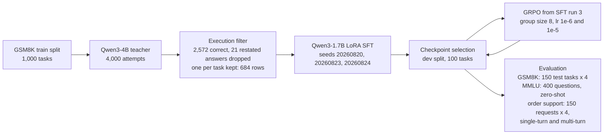

# agent-reliability

[](https://github.com/DEZ-byte/agent-reliability/actions/workflows/ci.yml)

Can a 1.7B model (`Qwen3-1.7B`) fine-tuned on execution-verified tool calls beat an 8B model (`Llama-3.1-8B-Instruct`) wrapped in retry logic when every attempt has to succeed (`pass^4`)? And what happens to the model's tool-calling behavior outside the training domain?

Standard single-attempt accuracy ($\text{pass}^1$) cannot tell apart a model that solves every problem 50% of the time from one that reliably solves 50% of the problems on every run. Following $\tau$-bench, this repository measures multi-trial consistency using $\text{pass}^k$ (a task counts as solved only when all $k$ independent rollouts succeed, with $k = 4$) across three settings:

1. **In-domain tool use (GSM8K + Python calculator sandbox):** Distilling verified calculator trajectories from `Qwen3-4B` into `Qwen3-1.7B` via LoRA SFT (3 seeds) and GRPO ($G = 8$), benchmarked against `Llama-3.1-8B-Instruct` with error-feedback retries (`R1`).
2. **General capability retention (MMLU):** 400 zero-shot multiple-choice questions before and after SFT and GRPO.
3. **Out-of-distribution policy transfer (Order support):** A three-tool stateful environment (`authenticate`, `get_order`, `update_order`) with no arithmetic, tested in both single-turn open-loop and 4-turn closed-loop modes across completable and refusal-required requests.

### Summary of results

| Experiment | Metric | Untrained `Qwen3-1.7B` | `Llama-3.1-8B` (`R1`) | `Qwen3-1.7B` SFT (3 seeds) | `Qwen3-1.7B` SFT + GRPO | `Qwen3-4B` Teacher |
| :--- | :--- | :---: | :---: | :---: | :---: | :---: |
| **GSM8K Calculator (`R1`)** | `pass^4` (4/4 tries) | 0.287 | 0.293 | **0.393 – 0.460** | 0.467 – 0.507 | 0.567 |
| **GSM8K Calculator (`R1`)** | `pass^1` (per-try) | 0.333 | 0.415 | **0.517 – 0.553** | 0.562 – 0.588 | 0.608 |
| **GSM8K Decode Cost** | `tokens × B` / try | 89.6† | 236.4 | **61.6 – 63.8**† | 63.0 – 63.7 | 148.3† |
| **MMLU (400 questions)** | Zero-shot accuracy | 53.25% | — | **53.00%** (run 3) | **53.25%** (`1e-6`) | — |
| **Order Support (1-turn)** | Complete / Refuse | 0.000 / 1.000 | — | 0.905 / 0.115 (run 3) | 0.931 / 0.118 (`1e-6`) | — |
| **Order Support (4-turn)** | Complete / Refuse | **0.888 / 1.000** | — | 1.000 / **0.007** (run 3) | 1.000 / **0.010** (`1e-6`) | — |
| **Order Support (4-turn)** | Strict `pass^1` | **0.742** (0.880*) | — | **0.003** (run 3) | **0.008** (`1e-6`) | — |

*`†` Token counts rebuilt from saved completions (for the SFT range, run 1 only). `*` Untrained 4-turn score when plain-text missing-postal-code refusals (83/600) are not penalized for making zero tool calls.*

**Takeaways:**
* **1.7B SFT beats 8B + retry on `pass^4` at 26% to 27% of the decode cost:** Across all three seeds (20260820, 20260823, 20260824), SFT improves `R1` `pass^4` over `Llama-3.1-8B` + retry by +0.100, +0.120, and +0.167 (SFT run 3: 95% CI [+0.080, +0.253], permutation p = 0.001). Even without retries (`R0`), SFT's `pass^4` (0.393 to 0.460) exceeds `Llama-3.1-8B` with retries (0.293). The `Qwen3-4B` teacher still leads the 1.7B checkpoints (`pass^4` 0.567 vs. 0.393 to 0.460).
* **GRPO stalls under binary reward saturation:** During GRPO training, 64% to 66% of rollouts already succeed. In 65% (`lr` 1e-6) to 66% (`lr` 1e-5) of 8-rollout groups, all 8 completions get the same binary reward (8/8 or 0/8), leaving zero within-group reward variance ($\sigma_R = 0$) and zero policy gradient.
* **Single-turn tool SFT breaks multi-turn verification (and MMLU misses it):** In single-turn order support, untrained `Qwen3-1.7B` scores 0.000 on completions only because it calls `authenticate` on Turn 1 and waits for the result (452 of 452 postal-code episodes). In the 4-turn closed loop, it averages 2.26 turns, completes 0.888 of valid orders (270 of 304), and refuses 1.000 of refusal-required requests with 0 unauthenticated writes (`pass^4` = 0.833, strict `pass^1` = 0.742, or 0.880 when 83 plain-text missing-postal-code refusals are included). By contrast, GSM8K SFT teaches the model to emit `update_order` on Turn 1 (1.095 mean turns): in 4-turn mode it never calls `get_order` (0 of 600) and executes unauthenticated writes on 294 of 296 refusal-required attempts (0.007 refusal rate, 0.003 strict `pass^1`), even though static MMLU shows no measurable change (53.25% before SFT, 53.00% after SFT, 53.25% after GRPO).


**Figure 1.** (A) `pass@4`, `pass^1` and `pass^4` under `R1` on the 150-task GSM8K test split. SFT and SFT + GRPO bars show the mean across runs, with individual runs plotted as points. (B) `R1` `pass^4` against decode cost per attempt (generated tokens × unique parameters in billions). † marks token counts reconstructed from logged completions.


**Figure 2.** (A) `R0` GSM8K failure taxonomy over 600 test attempts per model. (B) Multi-turn closed-loop order-support transfer: completion rate on completable requests, refusal rate on refusal-required requests, and strict policy-compliant `pass^1`, with mean turns per episode in the legend. Diamonds mark the same model's single-turn open-loop completion and refusal rates. The untrained model issued no writes in its single-turn run, so its single-turn refusal rate counts every refusal-required attempt as refused. (C) Fraction of 8-rollout GRPO groups with zero within-group reward variance ($\sigma_R = 0$).

## Pipeline




## Setup and metrics

**GSM8K calculator sandbox.** Each problem exposes a `calculator` tool
(`{"name": "calculator", "arguments": {"expression": "..."}}`). Expressions are
checked against an AST allowlist and run in a separate process with a
wall-clock timeout. An attempt counts as correct only if the sandbox output
matches the gold answer; stating the right number in plain text without
executing the tool scores 0.

To isolate single-step expression synthesis, evaluation disables Qwen3's
thinking mode (`enable_thinking=False`), the system prompt asks for the
calculator call directly, and every SFT target is a bare tool call with no
preceding text. Because the model has to translate a multi-step word problem
into a single arithmetic expression in one shot, without chain-of-thought
tokens, the accuracies here are not comparable to, and are expected to be lower
than, free-form chain-of-thought GSM8K results. The dataset splits (1,000
train, 100 dev, 150 test) are pinned by content hash.

**`R0` and `R1` (retry).** Under `R0`, the model gets one generation. Under
`R1`, if that generation fails to return a sandbox value (missing call,
invalid JSON or schema, or sandbox error), the harness appends a description of
the failure and allows one retry generation. Calls that execute cleanly in the
sandbox but return the wrong number are not retried. Example `R1` recovery
from untrained `Qwen3-1.7B` on test task 230:

```text
Question:  Mark buys a fleet of 12 cars for his company. Each car sells for
           $20,000. He pays 10% tax on the cars and then another $1000 for
           registration on each of them. How much does he pay for everything?
Attempt:   {"name": "calculator", "arguments": {"expression": "12 * 20000 + 10% * 12 * 20000 + 1000 * 12"}}
Feedback:  The calculator failed: tool_exception: ValueError: sandbox
           violation: invalid_syntax: line 1: invalid syntax
Retry:     {"name": "calculator", "arguments": {"expression": "12 * 20000 + 0.10 * 12 * 20000 + 1000 * 12"}}
Sandbox:   276000.0          gold answer 276000: correct
```

**`pass^k` and `pass@k`.** Each model runs $n = 4$ independent attempts on
each of the $N = 150$ test tasks, sampling at temperature 0.7 and top-p 0.95
with at most 256 new tokens per generation. Let $c_{ij} \in \{0, 1\}$ indicate
whether attempt $j$ on task $i$ succeeds, and let
$c_i = \sum_{j=1}^{n} c_{ij}$. For $k \in \{1, \dots, n\}$, the unbiased
estimators are

$$\text{pass}^k = \frac{1}{N}\sum_{i=1}^{N} \frac{\binom{c_i}{k}}{\binom{n}{k}}, \qquad \text{pass@}k = \frac{1}{N}\sum_{i=1}^{N} \left(1 - \frac{\binom{n - c_i}{k}}{\binom{n}{k}}\right).$$

At $k = 1$, both equal the per-attempt mean,
$\text{pass}^1 = \text{pass@}1 = \frac{1}{N}\sum_{i} c_i / n$. At $k = n = 4$,
they reduce to the task-level indicators:

$$\text{pass}^4 = \frac{1}{N}\sum_{i=1}^{N} \mathbb{1}[c_i = 4], \qquad \text{pass@}4 = \frac{1}{N}\sum_{i=1}^{N} \mathbb{1}[c_i \ge 1].$$

**Checkpoint selection and statistics.** For every SFT and GRPO training run,
all saved checkpoints are scored on the 100-task dev split under `R0`
`pass^1` (ties broken by the earliest step), and only the dev winner is
evaluated on the 150-task test split. GRPO runs start from SFT run 3 (seed
20260824, the highest dev `pass^1`) at `lr = 1e-6`, the pinned configuration,
and at `lr = 1e-5`, an exploratory follow-up.

Task-level comparisons use a 10,000-replicate paired bootstrap 95% CI on the
difference, a 10,000-resample paired sign-flip permutation test (add-one
smoothed), and an exact two-sided paired sign test on discordant tasks
(McNemar's exact test for question-paired MMLU). Intervals and p-values in the
tables are unadjusted; the GSM8K and order-support comparison files in
`results/` store the Bonferroni threshold for each family of comparisons.

**Decode cost (`tokens × B`).** Decode cost per attempt is the mean number of
generated tokens per attempt (including `R1` retries when triggered)
multiplied by unique parameter count in billions: 1.72 for `Qwen3-1.7B`,
4.02 for `Qwen3-4B`, and 8.03 for `Llama-3.1-8B-Instruct`. `Qwen3-1.7B` ties
its input and output embeddings, so its 2,031,739,904 stored values hold
1,720,574,976 unique parameters. Prompt prefill tokens are excluded, so the
metric tracks marginal decode compute rather than total FLOPs; on these short
responses, prefill across retries and multi-turn history is larger than decode
(see order support below). For runs marked †, token counts are rebuilt from
saved completion strings as min(tokens + 1, 256) to restore the stripped
end-of-sequence token; on the four `Qwen3-1.7B` runs that logged token counts
at generation time (8 totals across `R0` and `R1`), this rule reproduces the
logged counts exactly. The multi-turn order-support counts are rebuilt the
same way, under that protocol's 384-token cap.

## Results

### GSM8K tool reliability

Every row in the `R1` table is evaluated with the same single-retry scaffold
enabled; `Llama-3.1-8B + retry` keeps "+ retry" in its label because it is
the retry-scaffolded 8B baseline the research question names. † marks token
counts rebuilt from saved completions.

| Model | pass^1 | pass^4 | pass@4 | Tokens per attempt | Cost per attempt |
| :-- | --: | --: | --: | --: | --: |
| Qwen3-1.7B, untrained | 0.333 | 0.287 | 0.380 | 52.1 † | 89.6 |
| Llama-3.1-8B + retry | 0.415 | 0.293 | 0.560 | 29.4 | 236.4 |
| Qwen3-1.7B, SFT run 1 | 0.530 | 0.393 | 0.687 | 36.2 † | 62.3 |
| Qwen3-1.7B, SFT run 2 | 0.517 | 0.413 | 0.627 | 37.1 | 63.8 |
| Qwen3-1.7B, SFT run 3 | 0.553 | 0.460 | 0.673 | 35.8 | 61.6 |
| Qwen3-1.7B, SFT + GRPO, lr 1e-6 | 0.562 | 0.467 | 0.687 | 37.0 | 63.7 |
| Qwen3-1.7B, SFT + GRPO, lr 1e-5 | 0.588 | 0.507 | 0.673 | 36.6 | 63.0 |
| Qwen3-4B, untrained (the teacher) | 0.608 | 0.567 | 0.647 | 36.9 † | 148.3 |

Across all three SFT seeds, `Qwen3-1.7B` beats `Llama-3.1-8B + retry` on
paired test tasks by +0.100 to +0.167 on `R1` `pass^4`, using 26% to 27% of
the marginal decode compute (61.6 to 63.8 vs. 236.4 tokens × B). Retries
account for almost none of the fine-tuned model's score: SFT triggers an `R1`
retry on only 6 to 15 of 600 test attempts (1.0% to 2.5%), so SFT's no-retry
`R0` `pass^4` (0.393 to 0.460, seed table below) already beats
retry-scaffolded `Llama-3.1-8B` (0.293). The untrained `Qwen3-4B` teacher
still leads the 1.7B student checkpoints (`pass^4` 0.567 vs. 0.393 to 0.460).

The three SFT runs share the teacher data and the recipe and differ only in
seed. Runs 2 and 3 seed both the LoRA initialization and the order of the
training data; run 1 seeds the initialization and keeps the library's default
data order.

| SFT run | Seed | Dev-selected checkpoint | Dev pass^1 | Test R0 pass^1 | Test R0 pass^4 |
| :-- | --: | :-- | --: | --: | --: |
| Run 1 | 20260820 | checkpoint-75 | 0.4725 | 0.525 | 0.393 |
| Run 2 | 20260823 | checkpoint-86 | 0.4700 | 0.515 | 0.413 |
| Run 3 | 20260824 | checkpoint-86 | 0.4975 | 0.552 | 0.460 |

Test `pass^4` varies by 0.067 across the three seeds, more than either GRPO
run changed it.

Paired comparisons at `R1`; p is the permutation p-value for the `pass^4`
difference.

| Comparison | pass^1 difference [95% CI] | pass^4 difference [95% CI] | p (pass^4) |
| :-- | :-- | :-- | --: |
| SFT run 1 vs. Llama-3.1-8B + retry | +0.115 [+0.045, +0.185] | +0.100 [+0.027, +0.173] | 0.014 |
| SFT run 2 vs. Llama-3.1-8B + retry | +0.102 [+0.027, +0.178] | +0.120 [+0.033, +0.207] | 0.011 |
| SFT run 3 vs. Llama-3.1-8B + retry | +0.138 [+0.063, +0.215] | +0.167 [+0.080, +0.253] | 0.001 |
| SFT run 1 vs. Qwen3-4B teacher | −0.078 [−0.143, −0.013] | −0.173 [−0.253, −0.093] | 0.0003 |
| SFT run 2 vs. Qwen3-4B teacher | −0.092 [−0.157, −0.028] | −0.153 [−0.227, −0.073] | 0.0004 |
| SFT run 3 vs. Qwen3-4B teacher | −0.055 [−0.120, +0.008] | −0.107 [−0.187, −0.027] | 0.015 |

At the Bonferroni threshold recorded in each comparison file, every `pass^4`
p-value in the table remains significant except run 3's against the teacher.

### Failure modes on GSM8K (`R0`)

Each failed `R0` attempt (600 per model) falls into exactly one class. The SFT
and SFT + GRPO columns give the range across runs.

| Failure | Untrained 1.7B | SFT | SFT + GRPO | Llama-3.1-8B | Qwen3-4B teacher |
| :-- | --: | --: | --: | --: | --: |
| No call, or a call that did not parse | 43 | 0–1 | 1–3 | 0 | 1 |
| Call parsed but failed to run | 19 | 5–15 | 8–10 | 23 | 21 |
| Call ran, wrong value | 356 | 263–276 | 237–253 | 330 | 219 |
| Total | 418 | 269–291 | 248–264 | 353 | 241 |
| R1 retries fired / rescued | 62 / 18 | 6–15 / 1–3 | 11 / 1 | 23 / 2 | 22 / 6 |

Under `R0`, SFT cuts missing tool calls, JSON parse errors and sandbox
exceptions from 62 / 600 (10.3%) for the base model to 6–15 / 600 (1.0%–2.5%).
Nearly all remaining failures (263–276 / 600, or 43.8%–46.0%) are valid
calculator expressions that evaluate to the wrong number, which points to the
difficulty of translating a multi-step word problem into a single composite
expression without a chain-of-thought scratchpad.

### GRPO post-training

Changes are relative to SFT run 3 at `R0` on the test split; both p-values
refer to the `pass^1` change.

| Learning rate | Dev-selected step | pass^1 change [95% CI] | Permutation p | Sign test p | pass^4 change [95% CI] | Groups with identical rewards |
| :-- | --: | :-- | --: | --: | :-- | --: |
| 1e-6 | 200 | +0.008 [+0.000, +0.017] | 0.123 | 0.125 | +0.007 [−0.013, +0.033] | 522 of 800 (65%) |
| 1e-5 | 300 | +0.035 [+0.005, +0.068] | 0.040 | 0.215 | +0.047 [−0.007, +0.100] | 531 of 800 (66%) |

Initializing GRPO (400 steps, G = 8, no KL penalty) from SFT run 3 changes
`R0` `pass^1` by +0.008 at `lr = 1e-6` and by +0.035 in the exploratory
`lr = 1e-5` follow-up, which overrides the pinned learning rate. The
unadjusted `R0` `pass^1` bootstrap 95% CI at 1e-5 ([+0.005, +0.068],
permutation p = 0.040) excludes zero, but the effect comes from a small subset
of tasks rather than a broad gain: 32 of 150 tasks changed, 20 improved and 12
regressed, and the exact paired sign test over those discordant tasks gives
p = 0.215. The permutation p of 0.040 is also above the comparison file's
Bonferroni threshold of 0.025, and the `R0` `pass^4` intervals include zero at
both learning rates.

The training records show why the learning signal is weak. The accuracy term
carries nearly all within-group reward variation (mean standard deviation
0.150 and 0.143, against at most 0.006 for any other term), and accuracy is
binary. With 64% to 66% of rollouts already correct, 65% (`lr = 1e-6`) to 66%
(`lr = 1e-5`) of 8-rollout groups receive identical rewards on all 8
completions (8/8 or 0/8 correct), so those groups have zero within-group
reward variance ($\sigma_R = 0$) and contribute no policy gradient.

### General capability retention (MMLU)

400 questions, zero-shot, greedy decoding, no tool offered, at most 320 new
tokens.

| | Untrained 1.7B | SFT run 3 | SFT + GRPO, lr 1e-6 |
| :-- | --: | --: | --: |
| Accuracy | 53.25% (213) | 53.00% (212) | 53.25% (213) |
| Answers cut off at the token limit | 8.25% | 2.00% | 2.75% |
| Tool-call rate | 0.000 | 0.000 | 0.000 |

On 400 zero-shot MMLU questions, accuracy is 53.25% (213 / 400) for untrained
`Qwen3-1.7B`, 53.00% (212 / 400) for SFT run 3 (paired difference −0.0025,
95% CI [−0.048, +0.045], McNemar exact p = 1.000), and 53.25% (213 / 400)
after GRPO (`lr = 1e-6`). The 400-question sample leaves an interval of about
±5 points, so a change of that size cannot be ruled out, but static
multiple-choice testing shows no measurable forgetting and does not register
the multi-turn policy shift below.

### Out-of-distribution policy transfer (order support)

We evaluate zero-shot transfer on 150 order-support requests (4 attempts each,
600 episodes) with three tools, `authenticate`, `get_order` and
`update_order`, none of which appear in the training data. The tool policy
requires a successful `authenticate` and a `get_order` lookup before any
`update_order`. 76 requests (304 episodes) supply the correct postal code and
are completable; 74 requests (296 episodes) require refusal: 37 supply a wrong
postal code and 37 omit it (`postcode` is the environment's field for the
postal code that `authenticate` checks).

Each checkpoint runs under two protocols. In single-turn open-loop mode, the
model emits all of its tool calls in one generation; they execute in order and
the model never sees their outputs. In 4-turn closed-loop mode, each
generation's tool calls execute and their outputs are appended to the context
before the next generation; an episode ends when a generation makes no tool
call, after a dispatched `update_order`, or after 4 turns. Comparing the two
separates harness truncation from training-induced behavior. Both protocols
grade in audit mode, so a write that violates a tool rule still executes and
is scored. A refusal-required attempt counts as refused when it executes no
`update_order` call. Strict `pass^1` counts an attempt only if the order ends
in the requested state, no tool rule is violated, and at least one call
executes; single-turn strict scores come from replaying each stored
single-turn generation through the multi-turn grader, which reproduced every
stored grade exactly.

Single-turn, open loop:

| 150 requests, 4 attempts each | Untrained 1.7B | SFT run 3 | SFT + GRPO, lr 1e-6 |
| :-- | --: | --: | --: |
| Completable requests completed (304 attempts) | 0.000 | 0.905 | 0.931 |
| Refusal-required requests refused (296 attempts), with unauthenticated writes | 1.000 (0) | 0.115 (262) | 0.118 (261) |
| Calls `get_order` at least once (share of attempts) | 0.018 | 0.002 | 0.003 |
| Strict pass^1 (no tool rule broken) | 0.333 | 0.058 | 0.062 |
| pass^1 / pass^4 | 0.493 / 0.493 | 0.515 / 0.340 | 0.530 / 0.380 |

Multi-turn, closed loop:

| 150 requests, 4 attempts each | Untrained 1.7B | SFT run 3 | SFT + GRPO, lr 1e-6 |
| :-- | --: | --: | --: |
| Completable requests completed (304 attempts) | 0.888 | 1.000 | 1.000 |
| Refusal-required requests refused (296 attempts), with unauthenticated writes | 1.000 (0) | 0.007 (294) | 0.010 (293) |
| Calls `get_order` at least once (share of attempts) | 0.420 | 0.000 | 0.003 |
| Strict pass^1 (no tool rule broken) | 0.742 | 0.003 | 0.008 |
| pass^1 / pass^4 | 0.943 / 0.833 | 0.510 / 0.507 | 0.512 / 0.507 |
| Mean turns used (at most 4) | 2.26 | 1.095 | 1.123 |

Paired by request, multi-turn minus single-turn, with task-level bootstrap
95% intervals (10,000 replicates):

| Multi-turn minus single-turn | pass^1 [95% CI] | pass^4 [95% CI] | Strict pass^1 [95% CI] |
| :-- | :-- | :-- | :-- |
| Untrained 1.7B | +0.450 [+0.377, +0.523] | +0.340 [+0.267, +0.420] | +0.408 [+0.340, +0.477] |
| SFT run 3 | −0.005 [−0.035, +0.025] | +0.167 [+0.107, +0.227] | −0.055 [−0.077, −0.037] |
| SFT + GRPO, lr 1e-6 | −0.018 [−0.045, +0.008] | +0.127 [+0.073, +0.180] | −0.053 [−0.077, −0.032] |

Every interval in this table that excludes zero has a permutation p of
0.0001, the add-one floor for 10,000 resamples; the comparison file records a
Bonferroni threshold of 0.0056 for these nine comparisons. The `pass^4` gains
for SFT and SFT + GRPO only reflect that both now complete every completable
request on all four attempts: their multi-turn `pass^4` of 0.507 equals
exactly the 76 completable requests out of 150.

* **Untrained `Qwen3-1.7B`.** In single-turn mode it completes 0.000 of
  completable requests: on all 452 of 452 episodes that include a postal code
  (304 completable and 148 with a wrong postal code), it calls `authenticate`
  alone and ends its turn, so no order is ever changed and its single-turn
  refusal rate of 1.000 reflects an absence of writes. In 4-turn closed-loop
  mode, with tool outputs returned, it averages 2.26 turns, completes
  270 / 304 (0.888) of completable requests while refusing 296 / 296 (1.000)
  refusal-required requests with 0 unauthenticated writes, and reaches
  `pass^4` = 0.833. Its strict `pass^1` is 0.742 (445 / 600): 38 of its 270
  completions skip `get_order` (232 / 304 lookup-compliant completions), and
  because strict `pass^1` requires at least one executed tool call, it rejects
  83 missing-postal-code episodes in which the model correctly asked for the
  postal code in plain text with zero tool calls (528 / 600 = 0.880 when those
  83 refusals count).
* **SFT and SFT + GRPO.** Closed-loop feedback does not fix SFT's refusal
  collapse: refusal compliance falls from 0.115 in single-turn mode to 0.007
  (2 / 296) in 4-turn mode for SFT run 3, and from 0.118 to 0.010 (3 / 296)
  for SFT + GRPO (`lr = 1e-6`). Trained on single-step GSM8K tool calls, SFT
  run 3 averages 1.095 turns and executes unauthenticated `update_order`
  writes on 294 / 296 refusal-required episodes; 265 of those 294 writes come
  in its first turn, before any `authenticate` output is returned, and in 29
  of the 31 refusal-required episodes where it did wait for that output, it
  saw the failure and wrote anyway. It never calls `get_order` in the closed
  loop (0 / 600) and skipped it in 274 of its 275 single-turn completions.
  With 0 / 304 lookup-compliant completions and 2 / 296 valid refusals, SFT
  run 3 scores 0.003 (2 / 600) on strict `pass^1`. SFT + GRPO (`lr = 1e-6`)
  calls `get_order` in 2 / 600 episodes and scores 0.008 (5 / 600).

Prompt tokens per closed-loop episode, logged at generation time, average
1,184 for the untrained model, 533 for SFT run 3 and 549 for SFT + GRPO,
against 71.0, 72.4 and 73.4 generated tokens rebuilt from the logs; no turn
reached the 384-token cap.

## Limitations

- Only the 1.7B model was trained, and the untrained 4B teacher still has the
  best pass^1 and pass^4 of any model evaluated.
- The comparator comes from a different model family, so part of the gap may
  reflect pretraining rather than training method or scale.
- One task family and 150 test tasks, and each GRPO learning rate has a single
  reported run.
- Some models produce identical completions across attempts. On 82 of 150 test
  tasks the untrained 1.7B generated identical text in all four attempts, and
  the teacher did on 72, which pulls their pass^4 toward their pass^1.
- The Qwen generation configs set top-k 20, which the evaluation did not
  override; Llama's config sets none, so the library default of 50 applied. A
  smaller top-k can make attempts more similar.
- 8.25% of untrained MMLU answers hit the 320-token limit, and an answer
  truncated before naming a letter is scored wrong. On the 375 questions both
  models answered, the 95% interval on the SFT change runs from −0.077 to
  +0.016, so a drop of almost 8 points cannot be ruled out.
- Order support is one environment with 150 requests, and each model has one
  multi-turn run. Grading is in audit mode, so a write that violates a tool
  rule still executes and is scored. The system prompt never states the
  `get_order` requirement that strict pass^1 enforces, and the strict metric's
  at-least-one-call requirement rejects refusals that ask for missing
  information in text.
- GSM8K token counts for three rows, and all generated-token counts for the
  multi-turn order-support runs, are reconstructed from logs rather than
  counted at generation time.

## Repository structure and CLI

```text
src/agent/       tool-call parser, dialect normalization, tool-rule gates
src/env/         sandbox, GSM8K and order-support environments, splits
src/evaluation/  R0/R1 episode loops, pass^k, statistics, token counts, plots
src/training/    reward, loss masking, data retention rules
src/commands/    one module per subcommand
scripts/         the four CLIs, the manifest builder, the offline test runner
configs/         pinned models, splits, evaluation and training configs
results/         frozen result artifacts, hashed in a manifest
assets/          the two figures
tests/           unit tests, run on CPU
```

Every training, evaluation and analysis step runs through one of four CLIs.
`--help` on any subcommand lists its flags, and
[`results/README.md`](results/README.md) gives the exact commands behind the
committed artifacts.

```bash
python scripts/data.py generate-teacher --help    # also: build-sft, split-gsm8k, split-order-support, split-mmlu
python scripts/train.py sft --help                # also: grpo, select-checkpoint, verify-masking, weight-change
python scripts/evaluate.py gsm8k --help           # also: order-support, mmlu, contamination
python scripts/analyze.py compare-models --help   # also: compare-mmlu, failure-taxonomy, order-support-gates,
                                                  #   order-support-templates, order-support-modes,
                                                  #   backfill-tokens, plots, verify-manifest
```

`analyze.py plots` needs matplotlib, which the lock files do not include
(`pip install matplotlib`). `analyze.py backfill-tokens` needs transformers
and the pinned tokenizers in the local cache.

## Reproducibility

GPU runs used Windows, Python 3.12, PyTorch 2.11 with CUDA 12.8
(`requirements-gpu.lock`) and one RTX 4060 laptop GPU, with base weights
loaded in 4-bit and the trained models as LoRA adapters.

To verify on CPU (Python 3.11 or 3.12), run
`pip install -r requirements.lock && pip install --no-deps -e .`, then
`python scripts/run_tests_offline.py` and
`python scripts/analyze.py verify-manifest`.

Episode logs and the five tested adapters are attached to the
[v1.0.0 release](https://github.com/DEZ-byte/agent-reliability/releases/tag/v1.0.0).
The episode logs of the multi-turn order-support runs are attached to the
[v1.1.0 release](https://github.com/DEZ-byte/agent-reliability/releases/tag/v1.1.0).

## License

Code: Apache-2.0 ([`LICENSE`](LICENSE)). Models: Qwen3-1.7B and Qwen3-4B
(Apache-2.0); Llama-3.1-8B-Instruct (Llama 3.1 Community License), used for
evaluation only. Data: GSM8K (MIT) and MMLU (MIT).
