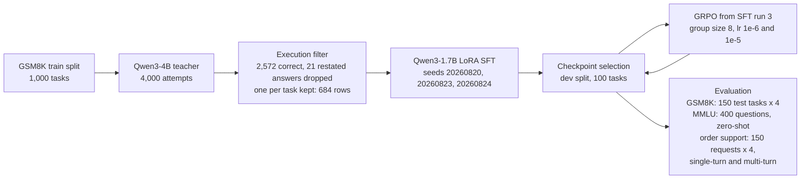

# Tool-Use Reliability in Small Language Models: Distillation, RL Post-Training, and Policy Transfer

[](https://github.com/DEZ-byte/agent-reliability/actions/workflows/ci.yml)

Single-trial accuracy ($\text{pass}^1$) conflates capability with consistency:
a model that solves every task half of the time and a model that always solves
the same half of the tasks have identical single-trial accuracy. The
multi-trial $\text{pass}^k$ metric, introduced with $\tau$-bench, separates the
two by scoring a task as solved only when all $k$ independent rollouts succeed.
This repository evaluates whether execution-verified trajectory distillation
(LoRA SFT on teacher rollouts whose calculator calls execute to the
ground-truth answer), followed by Group Relative Policy Optimization (GRPO)
with an execution-backed reward, can make a 1.7B model (Qwen3-1.7B) more
reliable under $\text{pass}^4$ than an 8B model (Llama-3.1-8B-Instruct) wrapped
in an error-feedback retry loop (R1). Beyond in-domain tool execution on
GSM8K, it measures general capability retention (zero-shot MMLU) and
out-of-distribution policy transfer to a three-tool order-support environment
under both single-turn open-loop and multi-turn closed-loop execution.

## Key findings

- **Execution-filtered SFT on Qwen3-1.7B beats retry-scaffolded Llama-3.1-8B
  on pass^4 at about a quarter of the per-attempt inference cost, but does not
  reach its Qwen3-4B teacher.** Across three training seeds (20260820,
  20260823, 20260824), LoRA SFT improves R1 pass^4 over Llama-3.1-8B + retry by
  +0.100, +0.120 and +0.167 on paired test tasks, and all three 95% bootstrap
  intervals exclude zero (SFT run 3: +0.167, 95% CI [+0.080, +0.253],
  permutation p = 0.001). Measured as generated tokens times unique parameter
  count (1.72B vs. 8.03B), one SFT attempt costs 26% to 27% of an 8B attempt
  (61.6 to 63.8 vs. 236.4 tokens × B). The teacher remains ahead of every
  student checkpoint (pass^4 0.567 vs. 0.393 to 0.460).
- **GRPO from SFT run 3 yields small gains, and binary reward saturation leaves
  65% to 66% of rollout groups without a learning signal.** With group size
  G = 8, GRPO changes R0 pass^1 by +0.008 at the pinned learning rate (1e-6)
  and by +0.035 in an exploratory run at 1e-5 (95% CI [+0.005, +0.068],
  permutation p = 0.040, exact sign test p = 0.215); the pass^4 interval
  includes zero at both rates. The reward is dominated by a binary accuracy
  term, so 65% (lr = 1e-6) to 66% (lr = 1e-5) of 8-rollout groups assign the
  same reward to all eight completions. Those groups have zero reward variance
  ($\sigma_R = 0$), every advantage in them is zero, and with no KL term they
  contribute no policy gradient.
- **On out-of-distribution order support, the untrained model's 0.000
  single-turn completion rate is an artifact of the open-loop protocol, while
  SFT's refusal collapse persists under closed-loop execution.** In a
  three-tool environment (`authenticate`, `get_order`, `update_order`),
  untrained Qwen3-1.7B completes 0.000 of completable requests in single-turn
  open-loop mode: on every request that supplies a postal code, it calls
  `authenticate` alone and ends its generation before the result exists. In
  multi-turn closed-loop mode (tool outputs appended to the context, at most 4
  turns), the untrained model averages 2.26 turns, completes 0.888 of
  completable requests and refuses 1.000 of refusal-required requests with 0
  unauthenticated writes (pass^4 = 0.833, strict policy-compliant
  pass^1 = 0.742). SFT run 3 refuses only 0.115 of refusal-required requests
  in single-turn mode and 0.007 in closed-loop mode, where 294 of 296 attempts
  execute unauthenticated writes. The untrained model issues no
  unauthenticated write under either protocol, so the behavior comes from SFT.
  Single-step GSM8K SFT induces horizon collapse: in the closed loop, SFT run 3
  averages 1.095 turns, 265 of its 294 unauthenticated writes come from a
  first turn that calls `update_order` before any `authenticate` result is
  returned, and it never calls `get_order`, for a strict pass^1 of 0.003.
  SFT + GRPO at lr 1e-6 behaves almost identically: it calls `get_order` in 2
  of 600 episodes and reaches a strict pass^1 of 0.008.
- **Static MMLU evaluation does not register the shift in multi-turn tool
  behavior.** Zero-shot MMLU accuracy on 400 questions is 53.25% for untrained
  Qwen3-1.7B and 53.00% for SFT run 3, a paired difference of −0.0025 (95% CI
  [−0.048, +0.045]). The benchmark shows no measurable change despite the
  policy degradation on order support, although the interval cannot rule out
  a change of up to about 5 points in either direction.


**Figure 1.** (A) pass@4, pass^1 and pass^4 under R1 on the 150-task GSM8K test
split. SFT and SFT + GRPO bars show the mean across runs, with individual runs
plotted as points. (B) R1 pass^4 against inference cost per attempt (generated
tokens × unique parameters in billions). † marks token counts reconstructed
from logged completions.


**Figure 2.** (A) R0 GSM8K failure taxonomy over 600 test attempts per model.
(B) Multi-turn closed-loop order-support transfer: completion rate on
completable requests, refusal rate on refusal-required requests, and strict
policy-compliant pass^1, with mean turns per episode in the legend. Diamonds
mark the same model's single-turn open-loop completion and refusal rates. The
untrained model issued no writes in its single-turn run, so its single-turn
refusal rate counts every refusal-required attempt as refused. (C) Fraction of
8-rollout GRPO groups with zero within-group reward variance ($\sigma_R = 0$).

## Pipeline



## Methodology and metrics

**Task and sandbox.** Each GSM8K problem exposes a single `calculator` tool.
The model must emit a JSON tool call whose arithmetic expression passes an AST
allowlist and executes in a separate process under a wall-clock timeout. An
attempt is scored correct only if the value returned by the sandbox matches the
ground-truth answer; a correct number stated in plain text without an executed
call scores zero. The splits contain 1,000 train, 100 dev and 150 test tasks
(train from the upstream GSM8K train split, dev and test from the upstream test
split), with every task pinned by content hash.

**R0 and R1.** Under R0 the model gets a single generation. Under R1, if that
generation returns no sandbox value (no tool call, an unparsable or
schema-invalid call, or a call that fails in the sandbox), the harness appends
a factual description of the failure to the conversation and allows one retry
generation. Calls that execute but return a wrong value are not retried. An R1
recovery by the untrained Qwen3-1.7B on test task 230:

```text
Question:  Mark buys a fleet of 12 cars for his company. Each car sells for
           $20,000. He pays 10% tax on the cars and then another $1000 for
           registration on each of them. How much does he pay for everything?
Attempt:   {"name": "calculator", "arguments": {"expression": "12 * 20000 + 10% * 12 * 20000 + 1000 * 12"}}
Feedback:  The calculator failed: tool_exception: ValueError: sandbox
           violation: invalid_syntax: line 1: invalid syntax
Retry:     {"name": "calculator", "arguments": {"expression": "12 * 20000 + 0.10 * 12 * 20000 + 1000 * 12"}}
Sandbox:   276000.0          gold answer 276000: correct
```

**pass^k and pass@k.** Each model makes $n = 4$ independent attempts on each of
the $N = 150$ test tasks. With $c_{ij} \in \{0, 1\}$ indicating whether attempt
$j$ on task $i$ succeeds,

$$\text{pass}^k = \frac{1}{N}\sum_i \mathbb{1}\Big[\sum_j c_{ij} = k\Big], \qquad \text{pass@}k = \frac{1}{N}\sum_i \mathbb{1}\Big[\sum_j c_{ij} \ge 1\Big],$$

for $k = 4$. $\text{pass}^1$ is the mean per-attempt accuracy. The harness
computes the unbiased combinatorial estimators $\binom{c_i}{k}/\binom{n}{k}$
and $1 - \binom{n - c_i}{k}/\binom{n}{k}$, which reduce to the indicator forms
above when $n = k$. All GSM8K evaluations, and the Qwen3-4B teacher runs that
generated the SFT data, sample at temperature 0.7 and top-p 0.95 with at most
256 new tokens per generation. GRPO training rollouts use a higher
temperature, recorded in each `grpo-run-*.json`.

**Checkpoint selection and experimental protocol.** The selection criterion
(dev split, R0, pass^1) was fixed in the training config, and the tie-break
(earliest checkpoint first) in the selection code, before any checkpoint was
scored on dev. Every saved checkpoint of every SFT and GRPO run is scored on
the 100-task dev split, and only each run's dev-selected checkpoint is
evaluated on the 150-task test split. The three SFT seeds and the GRPO run at
the pinned learning rate (1e-6) use the pinned training configuration. Three
decisions were made with test results already available: GRPO was initialized
from SFT run 3, the run with the highest dev pass^1, after all three SFT test
results were known and without a seed-selection rule fixed in advance; the
1e-5 run was added after the 1e-6 result; and both GRPO configurations were
retrained on the pinned base model after their first test evaluation (see
GRPO).

**Statistical testing.** All comparisons are paired at the task level. The
primary estimate is a task-level paired bootstrap 95% confidence interval on
the difference (10,000 replicates). Secondary p-values come from a paired
sign-flip permutation test (10,000 resamples, add-one smoothed so p is never
zero) and an exact two-sided paired sign test; MMLU is paired by question, with
McNemar's exact test as the sign test. Intervals and p-values are unadjusted
for multiple comparisons, since no correction was planned in advance. Each
GSM8K comparison file records the Bonferroni threshold for its own family of
tests; the MMLU comparison records none.

**Inference cost.** Cost per attempt is the mean number of generated tokens
per attempt, including the R1 retry generation when it fires, multiplied by
the model's unique parameter count in billions: 1.72 for Qwen3-1.7B, 4.02 for
Qwen3-4B and 8.03 for Llama-3.1-8B-Instruct. Tied weights are counted once:
Qwen3-1.7B ties its output head to its input embedding, so its checkpoint
stores 2,031,739,904 values but holds 1,720,574,976 unique parameters. Prompt
(prefill) tokens are excluded. The untrained Qwen3-1.7B, the Qwen3-4B teacher
and SFT run 1 were evaluated before the harness logged token counts, so their
counts (marked †) are reconstructed by re-tokenizing each logged completion
with the model's pinned tokenizer and counting min(tokens + 1, 256), which
adds back the end-of-sequence token that decoding strips. On the four
Qwen3-1.7B runs that logged token counts at generation time, the
reconstruction reproduces all 8 recorded R0 and R1 totals exactly. The
multi-turn order-support token counts are reconstructed the same way, under
that protocol's 384-token cap.

## Results

### GSM8K tool reliability

R1, 150 test tasks, 4 attempts each. † marks token counts reconstructed from
logged completions.

| Model | pass^1 | pass^4 | pass@4 | Tokens per attempt | Cost per attempt |
| :-- | --: | --: | --: | --: | --: |
| Qwen3-1.7B, untrained | 0.333 | 0.287 | 0.380 | 52.1 † | 89.6 |
| Llama-3.1-8B + retry | 0.415 | 0.293 | 0.560 | 29.4 | 236.4 |
| Qwen3-1.7B, SFT run 1 | 0.530 | 0.393 | 0.687 | 36.2 † | 62.3 |
| Qwen3-1.7B, SFT run 2 | 0.517 | 0.413 | 0.627 | 37.1 | 63.8 |
| Qwen3-1.7B, SFT run 3 | 0.553 | 0.460 | 0.673 | 35.8 | 61.6 |
| Qwen3-1.7B, SFT + GRPO, lr 1e-6 | 0.562 | 0.467 | 0.687 | 37.0 | 63.7 |
| Qwen3-1.7B, SFT + GRPO, lr 1e-5 | 0.588 | 0.507 | 0.673 | 36.6 | 63.0 |
| Qwen3-4B, untrained (the teacher) | 0.608 | 0.567 | 0.647 | 36.9 † | 148.3 |

The gap between pass@4 and pass^4 is the share of tasks a model solves only
intermittently. Llama-3.1-8B solves 0.560 of tasks at least once but only
0.293 on all four attempts. It generates the fewest tokens per attempt, but
each of its tokens is produced by about 4.7 times as many parameters as a
Qwen3-1.7B token, so its cost per attempt is the highest in the table. After
training, the retry rarely triggers (6 to 15 times in 600 attempts, against 62
for the untrained 1.7B), so R0 and R1 pass^4 are identical for every trained
model.

The three SFT runs share the teacher data and the recipe and differ only in
seed. Runs 2 and 3 seed both the LoRA initialization and the order of the
training data; run 1 seeds the initialization and keeps the library's default
data order.

| SFT run | Seed | Dev-selected checkpoint | Dev pass^1 | Test R0 pass^1 | Test R0 pass^4 |
| :-- | --: | :-- | --: | --: | --: |
| Run 1 | 20260820 | checkpoint-75 | 0.4725 | 0.525 | 0.393 |
| Run 2 | 20260823 | checkpoint-86 | 0.4700 | 0.515 | 0.413 |
| Run 3 | 20260824 | checkpoint-86 | 0.4975 | 0.552 | 0.460 |

Test pass^4 varies by 0.067 across the three seeds, more than either GRPO run
changed it.

Paired comparisons at R1; p is the permutation p-value for the pass^4
difference.

| Comparison | pass^1 difference [95% CI] | pass^4 difference [95% CI] | p (pass^4) |
| :-- | :-- | :-- | --: |
| SFT run 1 vs. Llama-3.1-8B + retry | +0.115 [+0.045, +0.185] | +0.100 [+0.027, +0.173] | 0.014 |
| SFT run 2 vs. Llama-3.1-8B + retry | +0.102 [+0.027, +0.178] | +0.120 [+0.033, +0.207] | 0.011 |
| SFT run 3 vs. Llama-3.1-8B + retry | +0.138 [+0.063, +0.215] | +0.167 [+0.080, +0.253] | 0.001 |
| SFT run 1 vs. Qwen3-4B teacher | −0.078 [−0.143, −0.013] | −0.173 [−0.253, −0.093] | 0.0003 |
| SFT run 2 vs. Qwen3-4B teacher | −0.092 [−0.157, −0.028] | −0.153 [−0.227, −0.073] | 0.0004 |
| SFT run 3 vs. Qwen3-4B teacher | −0.055 [−0.120, +0.008] | −0.107 [−0.187, −0.027] | 0.015 |

Against Llama-3.1-8B, all six intervals exclude zero. Against the teacher,
every pass^4 interval excludes zero and only run 3's pass^1 interval contains
it. At the Bonferroni threshold recorded in each comparison file, every pass^4
p-value in the table remains significant except run 3's against the teacher.

### Failure taxonomy

Each failed R0 attempt (600 per model) is assigned to exactly one class. The
SFT and SFT + GRPO columns give the range across runs.

| Failure | Untrained 1.7B | SFT | SFT + GRPO | Llama-3.1-8B | Qwen3-4B teacher |
| :-- | --: | --: | --: | --: | --: |
| No call, or a call that did not parse | 43 | 0–1 | 1–3 | 0 | 1 |
| Call parsed but failed to run | 19 | 5–15 | 8–10 | 23 | 21 |
| Call ran, wrong value | 356 | 263–276 | 237–253 | 330 | 219 |
| Total | 418 | 269–291 | 248–264 | 353 | 241 |
| R1 retries fired / rescued | 62 / 18 | 6–15 / 1–3 | 11 / 1 | 23 / 2 | 22 / 6 |

SFT nearly eliminates missing and unparsable tool calls. The remaining
failures are dominated by calls that execute cleanly but evaluate to an
incorrect value: 95% to 98% of SFT failures, up from 85% before training.
Because the retry fires only when no sandbox value comes back, it rescues 1 to
3 attempts per SFT run, against 18 of 62 for the untrained model.

### GRPO

Both runs initialize from SFT run 3, the SFT run with the highest dev pass^1
(0.4975). Each trains for 400 steps on prompts from the GSM8K train split, two
prompts per step, with 8 completions per prompt and a reward computed by
executing each completion.

The reported runs are a second training round. The first round's training
script loaded the base model without pinning its revision, so both learning
rates were retrained on the pinned base with an unchanged configuration, seed
and step budget after that round's test evaluation; in the first round, no R0
interval against SFT run 3 excluded zero. All GRPO numbers in this README,
including the MMLU and order-support columns, come from the retrained runs.
The first-round artifacts, including that round's MMLU and order-support
evaluations, are retired from `results/` and remain in the Git history.

The training config pins lr = 1e-6. The 1e-5 run overrides that value and,
according to its run record, started after the 1e-6 test comparison was
written, so it is an exploratory follow-up rather than a pre-registered test.

Changes are relative to SFT run 3 at R0 on the test split; both p-values refer
to the pass^1 change.

| Learning rate | Dev-selected step | pass^1 change [95% CI] | Permutation p | Sign test p | pass^4 change [95% CI] | Groups with identical rewards |
| :-- | --: | :-- | --: | --: | :-- | --: |
| 1e-6 | 200 | +0.008 [+0.000, +0.017] | 0.123 | 0.125 | +0.007 [−0.013, +0.033] | 522 of 800 (65%) |
| 1e-5 | 300 | +0.035 [+0.005, +0.068] | 0.040 | 0.215 | +0.047 [−0.007, +0.100] | 531 of 800 (66%) |

At 1e-5, the pass^1 interval (the primary estimate) excludes zero and the
permutation p is 0.040. The sign test does not reject, both pass^4 intervals
include zero, and none of these values is adjusted for multiple comparisons.

The GRPO advantage of completion $i$ in a group is
$A_i = (R_i - \bar{R}) / \sigma_R$. When all eight rewards in a group are
equal, $\sigma_R = 0$ and every advantage is zero; with the KL coefficient set
to zero, the group contributes nothing to the gradient. The accuracy term
accounts for nearly all within-group reward variation (mean standard deviation
0.150 and 0.143, against at most 0.006 for any other term), and accuracy is
binary, so a prompt the policy always solves and a prompt it never solves both
yield saturated groups. That was the case for about two thirds of training
groups.

### MMLU

400 questions, zero-shot, greedy decoding, no tool offered, at most 320 new
tokens.

| | Untrained 1.7B | SFT run 3 | SFT + GRPO, lr 1e-6 |
| :-- | --: | --: | --: |
| Accuracy | 53.25% (213) | 53.00% (212) | 53.25% (213) |
| Answers cut off at the token limit | 8.25% | 2.00% | 2.75% |
| Tool-call rate | 0.000 | 0.000 | 0.000 |

After SFT, the paired difference is −0.0025 (95% CI [−0.048, +0.045]), so a
change of up to about 5 points in either direction cannot be ruled out. 25
questions lack a parseable answer from the untrained or the SFT model, 21 of
them because generation hit the token limit. On the 375 questions where both
models produced an answer, the difference is −0.032 [−0.077, +0.016].

### Order-support transfer

The 150 test requests comprise 76 completable address changes and 74 that must
be refused: 37 omit the postal code and 37 supply the wrong one (`postcode` is
the environment's field for the postal code that `authenticate` checks). The
model has three tools, `authenticate`, `get_order` and `update_order`, none of
which appear in its training data. The tool policy requires a successful
`authenticate` and a `get_order` lookup before any `update_order`.

Each checkpoint is evaluated on the same requests, 4 attempts each, under two
protocols:

- **Single-turn (open loop).** The model emits all of its tool calls in one
  generation; they execute in order, and the model never observes their
  outputs.
- **Multi-turn (closed loop).** The tool calls in each generation execute, and
  their outputs are appended to the context as tool messages before the next
  generation. An episode terminates when a generation contains no tool call,
  after a generation whose `update_order` call was dispatched, or after 4
  generations (turns).

Both protocols grade in audit mode: a write that violates a tool rule still
executes and is scored. Strict pass^1 counts an attempt only if the order ends
in the requested state, no tool rule is violated and at least one call
executes. The single-turn logs do not store this metric, so every stored
single-turn generation was replayed as a one-turn episode through the
multi-turn grader, which reproduced every stored grade exactly.

Single-turn, open loop:

| 150 requests, 4 attempts each | Untrained 1.7B | SFT run 3 | SFT + GRPO, lr 1e-6 |
| :-- | --: | --: | --: |
| Completable requests completed (304 attempts) | 0.000 | 0.905 | 0.931 |
| Refusal-required requests refused (296 attempts), with unauthenticated writes | 1.000 (0) | 0.115 (262) | 0.118 (261) |
| Calls `get_order` at least once (share of attempts) | 0.018 | 0.002 | 0.003 |
| Strict pass^1 (no tool rule broken) | 0.333 | 0.058 | 0.062 |
| pass^1 / pass^4 | 0.493 / 0.493 | 0.515 / 0.340 | 0.530 / 0.380 |

Multi-turn, closed loop:

| 150 requests, 4 attempts each | Untrained 1.7B | SFT run 3 | SFT + GRPO, lr 1e-6 |
| :-- | --: | --: | --: |
| Completable requests completed (304 attempts) | 0.888 | 1.000 | 1.000 |
| Refusal-required requests refused (296 attempts), with unauthenticated writes | 1.000 (0) | 0.007 (294) | 0.010 (293) |
| Calls `get_order` at least once (share of attempts) | 0.420 | 0.000 | 0.003 |
| Strict pass^1 (no tool rule broken) | 0.742 | 0.003 | 0.008 |
| pass^1 / pass^4 | 0.943 / 0.833 | 0.510 / 0.507 | 0.512 / 0.507 |
| Mean turns used (at most 4) | 2.26 | 1.095 | 1.123 |

Paired by request, multi-turn minus single-turn, with task-level bootstrap
95% intervals (10,000 replicates):

| Multi-turn minus single-turn | pass^1 [95% CI] | pass^4 [95% CI] | Strict pass^1 [95% CI] |
| :-- | :-- | :-- | :-- |
| Untrained 1.7B | +0.450 [+0.377, +0.523] | +0.340 [+0.267, +0.420] | +0.408 [+0.340, +0.477] |
| SFT run 3 | −0.005 [−0.035, +0.025] | +0.167 [+0.107, +0.227] | −0.055 [−0.077, −0.037] |
| SFT + GRPO, lr 1e-6 | −0.018 [−0.045, +0.008] | +0.127 [+0.073, +0.180] | −0.053 [−0.077, −0.032] |

Every interval in this table that excludes zero has a permutation p of
0.0001, the add-one floor for 10,000 resamples. The Bonferroni threshold for
these nine comparisons is 0.0056; the comparison file records it, but no
correction was planned in advance.

**The untrained model's zero single-turn completion rate is a protocol
artifact.** In the single-turn run it called `authenticate` alone on every
request that supplied a postal code (452 of 452 episodes), which the
single-turn grader scores as a correct refusal on wrong-postal-code requests.
On requests without a postal code, 96 of its 148 generations contained no tool
call. With tool outputs fed back, it averages 2.26 turns, completes 0.888 of
completable requests and refuses 1.000 of refusal-required requests with 0
unauthenticated writes. Its pass^4 is 0.833, and its strict pass^1 rises from
0.333 single-turn to 0.742, a gain of 0.408. Of its 274 write attempts on
completable requests, 39 skipped `get_order`.

**SFT run 3 still writes on refusal-required requests when tool outputs are
visible.** In the closed loop it never calls `get_order`, refuses 0.007 of
refusal-required requests (294 of 296 attempts wrote without authentication)
and reaches a strict pass^1 of 0.003. Most of this failure is horizon
collapse. Every SFT example is a single generation containing one tool call,
and the resulting policy tries to finish the task in one turn: it averages
1.095 turns per episode, and in 549 of 600 episodes its first turn already
calls `update_order` before any `authenticate` result is returned, including
265 of the 296 refusal-required attempts. Under the same protocol, the
untrained model called `update_order` in its first turn in 0 of 600 episodes.
Horizon collapse does not explain all of it: in 29 of the 31
refusal-required attempts where SFT run 3 waited for the `authenticate`
result, it observed the failure and wrote anyway. SFT + GRPO at lr 1e-6
behaves almost identically, with 1.123 turns on average, a first-turn
`update_order` in 534 of 600 episodes, a refusal rate of 0.010 (293 of 296
attempts wrote without authentication), a strict pass^1 of 0.008, and a write
after a failed `authenticate` in 39 of the 42 refusal-required attempts that
waited for it. Both models' pass^4 rises only because they now complete every
completable request on all four attempts: their multi-turn pass^4 of 0.507
equals exactly the 76 completable requests out of 150.

In the single-turn run, 274 of SFT run 3's 275 completed address changes
skipped `get_order`, and in the closed loop all 304 of its writes on
completable requests did. The system prompt instructs the model to verify the
customer before changing an order but never mentions the lookup. Refusal was
harder to measure in the single-turn run: the generation was complete before
`authenticate` executed, so only requests without a postal code could exhibit
a refusal. SFT still wrote on 124 of 148 of those, and GRPO on 122.

Generated tokens per multi-turn episode, reconstructed from the logs, were
71.0 for the untrained model, 72.4 for SFT run 3 and 73.4 for SFT + GRPO; no
turn reached the 384-token cap. Prompt tokens were logged at generation time.
Because each turn's prompt includes the full conversation so far, the
untrained model's longer episodes average 1,184 prompt tokens per episode,
against 533 for SFT run 3 and 549 for SFT + GRPO.

## Limitations

- Only the 1.7B model was trained, and the untrained 4B teacher still has the
  best pass^1 and pass^4 of any model evaluated.
- The comparator comes from a different model family, so part of the gap may
  reflect pretraining rather than training method or scale.
- One task family and 150 test tasks. Each GRPO learning rate has a single
  reported run, from the second training round (see GRPO).
- Some models produce identical completions across attempts. On 82 of 150 test
  tasks the untrained 1.7B generated identical text in all four attempts, and
  the teacher did on 72, which pulls their pass^4 toward their pass^1.
- The Qwen generation configs set top-k 20, which the evaluation did not
  override; Llama's config sets none, so the library default of 50 applied. A
  smaller top-k can make attempts more similar.
- 8.25% of untrained MMLU answers hit the 320-token limit, and an answer
  truncated before naming a letter is scored wrong. On the 375 questions both
  models answered, the 95% interval on the SFT change runs from −0.077 to
  +0.016, so a drop of almost 8 points cannot be ruled out.
- Order support is one environment with 150 requests, and each model has one
  multi-turn run. Grading is in audit mode, so a write that violates a tool
  rule still executes and is scored, and the system prompt never states the
  `get_order` requirement that strict pass^1 enforces.
- GSM8K token counts for three rows, and all generated-token counts for the
  multi-turn order-support runs, are reconstructed from logs rather than
  counted at generation time.

## Repository layout and usage

```text
src/agent/       tool-call parser, dialect normalization, tool-rule gates
src/env/         sandbox, GSM8K and order-support environments, splits
src/evaluation/  R0/R1 episode loops, pass^k, statistics, token counts, plots
src/training/    reward, loss masking, data retention rules
src/commands/    one module per subcommand
scripts/         the four CLIs, the manifest builder, the offline test runner
configs/         pinned models, splits, evaluation and training configs
results/         frozen result artifacts, hashed in a manifest
assets/          the two figures
tests/           unit tests, run on CPU
```

Every training, evaluation and analysis step runs through one of four CLIs.
`--help` on any subcommand lists its flags, and
[`results/README.md`](results/README.md) gives the exact commands behind the
committed artifacts.

```bash
python scripts/data.py generate-teacher --help    # also: build-sft, split-gsm8k, split-order-support, split-mmlu
python scripts/train.py sft --help                # also: grpo, select-checkpoint, verify-masking, weight-change
python scripts/evaluate.py gsm8k --help           # also: order-support, mmlu, contamination
python scripts/analyze.py compare-models --help   # also: compare-mmlu, failure-taxonomy, order-support-gates,
                                                  #   order-support-templates, order-support-modes,
                                                  #   backfill-tokens, plots, verify-manifest
```

`analyze.py plots` needs matplotlib, which the lock files do not include
(`pip install matplotlib`). `analyze.py backfill-tokens` needs transformers
and the pinned tokenizers in the local cache.

---

GPU runs used Windows, Python 3.12, PyTorch 2.11 with CUDA 12.8
(`requirements-gpu.lock`) and one RTX 4060 laptop GPU, with base weights
loaded in 4-bit and the trained models as LoRA adapters.

To verify on CPU (Python 3.11 or 3.12), run
`pip install -r requirements.lock && pip install --no-deps -e .`, then
`python scripts/run_tests_offline.py` and
`python scripts/analyze.py verify-manifest`.

Episode logs and the five tested adapters are attached to the
[v1.0.0 release](https://github.com/DEZ-byte/agent-reliability/releases/tag/v1.0.0).
The episode logs of the multi-turn order-support runs are attached to the
[v1.1.0 release](https://github.com/DEZ-byte/agent-reliability/releases/tag/v1.1.0).

## License

Code: Apache-2.0 ([`LICENSE`](LICENSE)). Models: Qwen3-1.7B and Qwen3-4B
(Apache-2.0); Llama-3.1-8B-Instruct (Llama 3.1 Community License), used for
evaluation only. Data: GSM8K (MIT) and MMLU (MIT).
